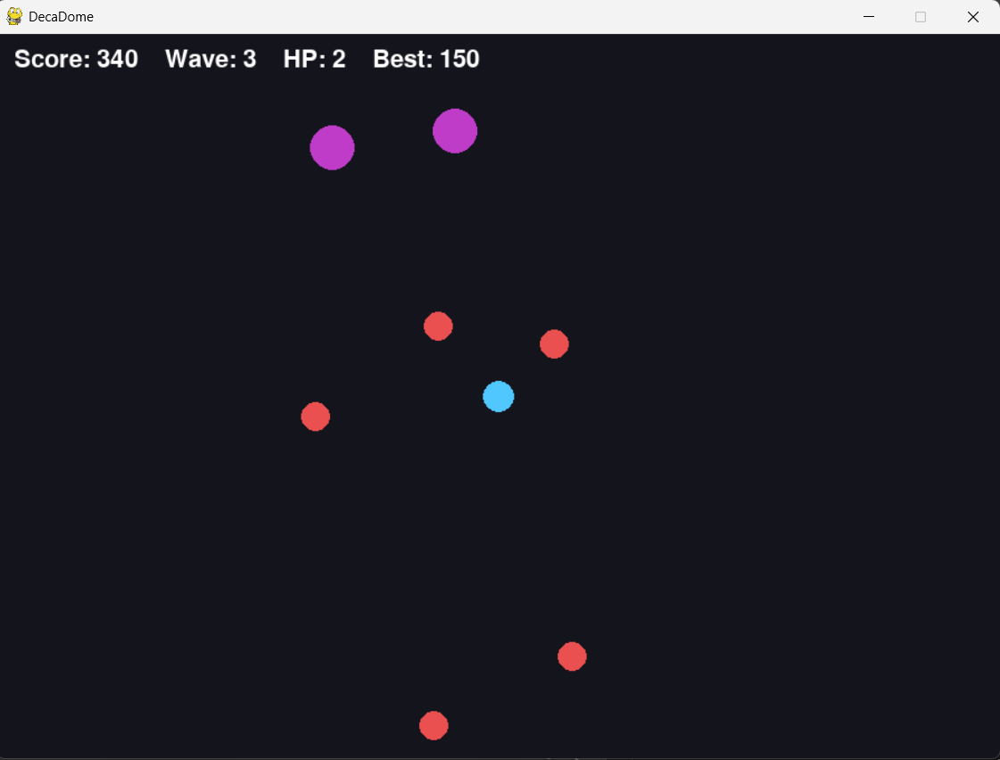

#2D Arena Survival Shooter

[](https://github.com/Stray3rdBorn/2D-Game-Project/actions/workflows/ci.yml)

A 2D top down arena shooter built with Python and Pygame, with an online leaderboard. Survive 10 waves of enemies that chase you across a single screen, clear every wave to win, and see how your best score ranks against other players.

<!-- Add a screenshot or GIF here:  -->

## How the pieces fit together

```
Pygame game ──▶ FastAPI (port 8000) ──▶ PostgreSQL   permanent record of every score
                        │
                        └─────────────▶ Redis        fast ranking of best scores

Browser ──────▶ Django (port 8001) ───▶ PostgreSQL   accounts, API keys, leaderboard page, admin
```

| Part          | Role                                                                                                 |
| ------------- | ---------------------------------------------------------------------------------------------------- |
| Pygame client | The game. Sends the final score to the API when a run ends                                           |
| FastAPI       | `POST /scores` (needs an API key) and `GET /leaderboard`                                             |
| Django        | Registration, login, API keys, profile page with your own runs, public leaderboard page, admin panel |
| PostgreSQL    | Stores users, API keys and every submitted score                                                     |
| Redis         | Sorted set holding each player's best score for instant ranking                                      |

The leaderboard is read from Redis. If Redis is down or empty, the API falls back to PostgreSQL. Redis is rebuilt from PostgreSQL when the API starts, and also when a new score arrives and Redis is found empty.

## Gameplay

You control a blue circle in the middle of the arena. Enemies spawn just outside the screen edges and walk straight at you. Clear all 10 waves to reach the win screen. If your HP reaches zero first, the run is over.

**Enemies**

| Enemy | Color  | HP  | Size  | Speed             | Points |
| ----- | ------ | --- | ----- | ----------------- | ------ |
| Grunt | Red    | 1   | Small | Full wave speed   | 10     |
| Tank  | Purple | 3   | Large | 60% of wave speed | 30     |

Tanks do not appear in wave 1. Each wave adds 10 percentage points to the chance that a spawn is a tank, up to a cap of 60% from wave 7 onward.

**Player**

- 5 HP at the start of a run.
- Touching an enemy removes that enemy and costs 1 HP. You are then immune for 1 second, and the player blinks while immune.
- Moves faster than any enemy, so running away always works.

**Waves and scoring**

- Wave `n` spawns `5 + 5n` enemies, one every 0.6 seconds, from random points just outside the four screen edges.
- Enemy speed is `70 + 12n` pixels per second, capped at 220.
- Each kill gives its enemy's points: 10 for a grunt, 30 for a tank.
- Clearing wave `n` gives a bonus of `50 * n` points, followed by a 3 second break before the next wave.
- Clearing wave 10 ends the game with a win. Dying on the same frame as the final kill counts as a loss.
- Your best score is saved locally in `highscore.json` when a run ends, whether you win or lose.

## Controls

| Action           | Input                         |
| ---------------- | ----------------------------- |
| Move             | `W` `A` `S` `D` or arrow keys |
| Aim              | Mouse                         |
| Shoot            | Hold left mouse button        |
| Start or restart | `Space`                       |
| Quit             | `Esc` or close the window     |

## Run the game

Requires Python 3.12 or newer.

```bash
git clone https://github.com/Stray3rdBorn/2D-Game-Project.git
cd 2D-Game-Project

python -m venv venv
venv\Scripts\activate          # Windows
# source venv/bin/activate     # macOS and Linux

pip install -r requirements.txt
python client/main.py
```

The game works fully offline. To upload scores, create `client/.env` with the key from your profile page on the website:

```
ARENA_API_URL=http://127.0.0.1:8000
ARENA_API_KEY=your-key-here
```

## Run the server

Requires PostgreSQL and Redis (Memurai works as Redis on Windows).

```bash
cd server
python -m venv venv
venv\Scripts\activate          # Windows
# source venv/bin/activate     # macOS and Linux

pip install -r requirements.txt
```

Create `server/.env` from `server/.env.example` and fill in your database user, password and a random `SECRET_KEY`. Then:

```bash
# Terminal 1: score API at http://127.0.0.1:8000, interactive docs at /docs
python -m uvicorn app.main:app --reload

# Terminal 2: website at http://127.0.0.1:8001
cd web
python manage.py makemigrations accounts
python manage.py migrate
python manage.py createsuperuser
python manage.py runserver 8001
```

### With Docker

```bash
docker compose up --build
```

This starts PostgreSQL, Redis, the API on port 8000 and the website on port 8001. Create an admin account with `docker compose exec web python manage.py createsuperuser`. The passwords in `docker-compose.yml` are for local development only.

## API

| Method and path             | Auth               | Description                                                                                             |
| --------------------------- | ------------------ | ------------------------------------------------------------------------------------------------------- |
| `GET /health`               | none               | Returns `{"status": "ok"}`                                                                              |
| `POST /scores`              | `X-API-Key` header | Saves a run: `{"score": 1200, "wave_reached": 4, "won": false}`. The player name comes from the account |
| `GET /leaderboard?limit=10` | none               | Best score per player, ranked, from Redis with a PostgreSQL fallback                                    |

A missing or unknown key returns `401`. Invalid values return `422`.

## Tests

```bash
# Game tests, from the project root
pip install pytest
pytest

# Server tests, from the server folder
cd server
pip install -r requirements-dev.txt
python -m pytest
```

The game tests run Pygame without a window and cover collision, screen bounds, movement, hit immunity, enemy chasing, tank spawning, wave growth, high score saving and a headless 10 second run. The server tests use an in memory database and an in memory Redis stand in, so they need no running services. They cover the key check, input validation, ranking by best score, the PostgreSQL fallback when Redis is empty, and the API continuing to work when Redis is down.

## Continuous integration

`.github/workflows/ci.yml` runs on every push and pull request to `main`:

1. **Game**: lint and tests on Python 3.12 and 3.13.
2. **Server**: lint and tests on Python 3.12 and 3.13.
3. **Docker**: builds the images with Docker Compose, starts the stack and checks that the API and website respond.

## How the game works

The whole game is one loop that runs 60 times per second: read input, update the game state, draw the frame, repeat.

- **Game loop.** Update and draw are separate steps. State changes happen as numbers inside Python objects, and the screen is repainted from those numbers every frame.
- **Delta time.** All movement is multiplied by the seconds since the last frame, so speed stays the same on slow and fast machines. The value is capped at 0.05 seconds to avoid large jumps after a freeze.
- **State machine.** The game is always in exactly one state: `menu`, `playing`, `victory`, or `game_over`. Each frame runs only the code for the current state.
- **Vector movement.** Movement is direction times speed times delta time. Directions are normalized so diagonal movement is not faster.
- **Circle collision.** Every object is a circle, and two objects collide when the distance between their centers is smaller than the sum of their radii.
- **Data driven enemies.** One `Enemy` class holds HP, radius, color, speed, and points. A tank is the same class created with different values, chosen by a weighted random roll when it spawns.

## Project structure

```
client/
    main.py              # The game: settings, Player, Bullet, Enemy, Game loop
    api.py               # Sends the score to the API in a background thread
tests/
    test_game.py         # Game tests, run headless
server/
    app/
        main.py          # FastAPI endpoints and API key check
        models.py        # SQLAlchemy tables (scores) and read only views of Django tables
        schemas.py       # Request and response shapes
        database.py      # PostgreSQL connection
        cache.py         # Redis connection
        ranking.py       # Redis leaderboard with PostgreSQL fallback
    web/                 # Django project: accounts, API keys, leaderboard page, admin
    tests/               # Server tests
    Dockerfile
docker-compose.yml       # PostgreSQL, Redis, API and website
.github/workflows/ci.yml # GitHub Actions workflow
requirements.txt         # Game dependencies
README.md
```

## Tech stack

Python, Pygame, FastAPI, Django, PostgreSQL, SQLAlchemy, Redis, Docker Compose, pytest, flake8, GitHub Actions
